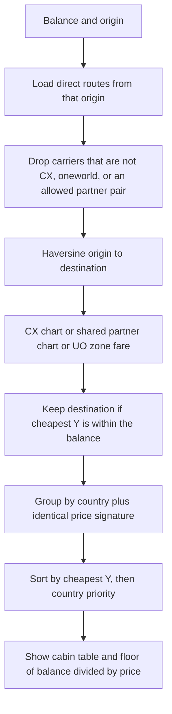
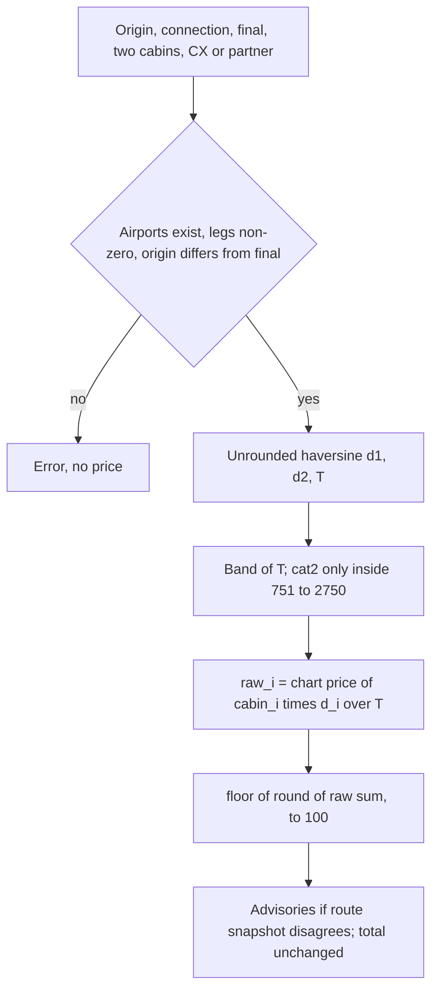
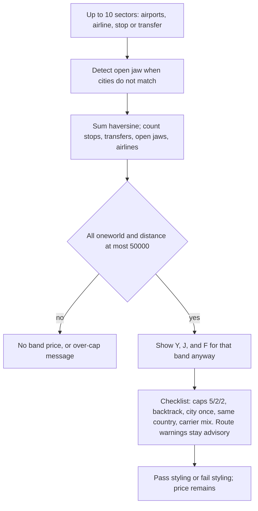
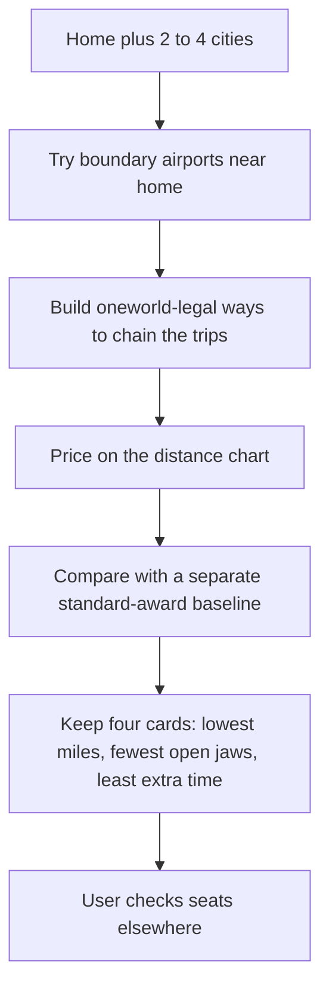

# FlyAsia Asia Miles Tools Research

Research date: 2026-10-15. Scope is product design, data, and pricing logic for Asia Miles Optimizer V2. FlyAsia is a third-party site. Nothing below is a Cathay Pacific or Asia Miles official rule unless a FlyAsia page itself quotes one, and even then the quote is FlyAsia’s rendering.

Evidence tags used throughout:

| Tag | Meaning |
|---|---|
| `VERIFIED_BY_TOOL` | Reproduced on the public tool or by executing the same client module the page ships, and checked against the server-rendered default or a recorded UI case |
| `DOCUMENTED_BY_SITE` | Stated on a FlyAsia page or tutorial; not re-run inside a gated tool |
| `OBSERVED` | Seen in page HTML, embedded chart JSON, the public calculator script, or a logged-out live browser session |
| `INFERRED` | A compact rule that fits the observed cases. Not an official rule |
| `UNKNOWN` | Not observed and not stated |

`DOCUMENTED` in older notes means the same thing as `DOCUMENTED_BY_SITE`.

## Executive Summary

FlyAsia ships four related Asia Miles planners. Three are public. One is membership-gated.

1. **Award map** (`/miles/asia-miles/idea/`) answers “with this many miles, which *direct* destinations from an origin are affordable, on which airline chart, in which cabin, and how many one-ways does that balance cover?” It does not search connections, dates, leave, or award seats.
2. **Mixed-cabin calculator** (`/miles/asia-miles/calculator/`) prices exactly one one-way ticket of two connected segments. Miles are a distance-weighted blend of each cabin’s price at the *total* distance band, then rounded down to 100. It is not highest-cabin pricing.
3. **oneworld round-the-world validator** (`/miles/asia-miles/oneworld-planner/`) is a manual multi-segment distance-band checker. It is not the multi-trip split planner. It prices the whole ticket on one Y/J/F band and checks stopover, transfer, open-jaw, carrier-mix, same-country, backtrack, and city-once rules. It still shows a price when rules fail.
4. **分段兌換規劃器** (`/miles/asia-miles/split-planner/`) is the multi-trip searcher described in the 2026-10-09/12 tutorial. On 2026-10-15 a logged-out browser showed a membership gate and no scheme cards: 「需要升級會籍才能解鎖」, 「檢查會員等級」, and an “Already a member” login. The tutorial says access is closed beta, granted for 12 months with 《Asia Miles 精讀手冊》 purchased through 2026-12-31. This research did not bypass that gate. The tutorial’s London+Tokyo scheme 1 (170,000 vs separate 215,000, save 45,000) and scheme 3 (210,000 vs 248,000, save 38,000) are `DOCUMENTED_BY_SITE`. The same skeletons, entered by hand into the *public* round-the-world validator, reproduce 13,529 miles / J 170,000 and 16,686 miles / J 210,000.

Strongest design lesson for V2: keep route evidence, chart arithmetic, award seats, taxes, and ticketability as separate fields. FlyAsia already separates some of these in prose, then occasionally blurs them in warnings (a Category 2 alert can appear on a band that has no Category 2 price).

V1.1 `standard_mixed` is the same *idea* as the mixed-cabin calculator (pro-rate each cabin’s total-band price by great-circle share, floor to 100, two Cathay segments, one-way). It is not the same implementation: V1.1 floors the raw sum, FlyAsia rounds the raw sum to the nearest mile first; V1.1 requires an explicit `route_type`; FlyAsia infers Category 2 from airport countries. Do not treat a match as official correctness.

## Method

Hands-on target was each public tool with varied cases.

What worked:

- Server-rendered HTML for the award map (default HKG, plus `?origin=TPE` and `?origin=SYD`), the mixed-cabin calculator default, and the round-the-world validator default.
- The public scripts `calculator.js`, `mix-calculator.js`, and `oneworld-calculator.js`, with the chart objects embedded in those pages and `airports.json` (`ver=1.133.0`, HTTP `Last-Modified` / reader timestamp Tue, 29 Sep 2026, 9,800 airports).
- Default server HTML matched the module output: map 15,000 miles → 73 destinations, cheapest 4,000 (economy, Taiwan); mixed cabin TPE–HKG–HND J+Y → 17,300; round-the-world default → 24,096 miles, Y 126,000 / J 250,000 / F 350,000, 3 stopovers, 0 transfers, 1 open jaw.
- A separate hands-on UI pass on the mixed-cabin calculator supplied the HKG–TPE–NRT matrix below. Those totals match this module execution exactly (`VERIFIED_BY_TOOL`).

What did not work in the first pass:

- Headless Chrome stopped on a Cloudflare “Just a moment…” interstitial, so that pass did not click through a live browser. Module execution plus server-rendered defaults was the substitute.
- Parallel fetches of some `?origin=` URLs hit a captcha redirect. TPE and SYD completed on retry. NRT and LHR were not captured in that pass.
- The split planner was not operated. No paywall bypass was attempted.

Later logged-out live browser session (`OBSERVED`, 2026-10-15; award-map page stamp 11:36 HKT):

- The award map was used for HKG balance steps and for origins TPE, NRT, LHR, and SYD. Those counts close the earlier NRT/LHR gap. Where the same balance was also run in the module, the destination counts match.
- Round-the-world cases L1–L6c below were typed into the page. Route-existence warnings were advisory and did not fail a checklist row. An earlier reading of `oneworld-calculator.js` treated `other_carrier` as a hard `route_carrier_ok` failure. The live page supersedes that reading for product behavior.
- The split planner, still logged out, showed only the membership gate. Confirmed blocker. Not bypassed.

The mixed-cabin formula stays `INFERRED`. This live session did not re-open that calculator.

Cabin letters used below: Y economy, W premium economy (`premium` in the FlyAsia UI), J business, F first.

---

## Tool 1 — Award Map

URL: https://www.flyasia.co/miles/asia-miles/idea/

Page dates (`OBSERVED` in Yoast JSON-LD): published 2026-07-17, modified 2026-07-20. Description on the page: the map enumerates routes from Hong Kong that can be redeemed with Asia Miles and shows economy and business miles. The widget itself also has a free-text origin, so “Hong Kong only” is the default, not a hard limit (`OBSERVED`).

### Q1. What question does the tool answer?

`DOCUMENTED_BY_SITE` / `OBSERVED`: “你有多少 Asia Miles？” Enter a mileage balance and an origin. The tool lists direct destinations whose cheapest economy award is within that balance, with a small cabin table per airline and a “×N 程” one-way count. It is a balance-to-destination browser, not an itinerary builder.

### Q2. What are the inputs, defaults, and bounds?

`OBSERVED` in the HKG widget HTML:

| Input | Default | Constraint |
|---|---|---|
| Miles | 15,000 | `<input type="number">` min 1,000, max 999,999, step 1,000 |
| Origin | `HKG 香港` | Free text. Selecting an airport navigates to `?origin=CODE` (full reload, not an in-page recompute) |
| Region chips | 全部 | 東亞, 東南亞, 南亞, 中東, 歐洲, 北美洲, 大洋洲 |
| Button | 立即查看 | Enter in the miles field also recalculates |

`OBSERVED` in the logged-out browser: miles default to 15,000, and the field minimum is 1,000. Origin is an autocomplete. The default is HKG. Choosing an airport sets `?origin=CODE`. Region chips are 全部, 東亞, 東南亞, 南亞, 中東, 歐洲, 北美洲, 大洋洲. There is no cabin filter, no airline filter, and no date filter.

Below 4,000 miles the page shows an insufficient-miles message. The HKG floor is UO Taiwan at 4,000. An earlier module run of 999 and 1,000 returned an empty destination set; the user-visible state in the live session is that message. The script still rejects only a non-integer or a value below 1 (`OBSERVED`). The HTML `min=1000` is the control the live page enforces.

### Q3. Which origins work?

`OBSERVED`: any airport code the autocomplete can resolve. The old fixed list of about 22 origins is commented as retired on 2026-09-23. The active origin’s coordinates are stored in fields still named `hkgLat` / `hkgLng`.

`VERIFIED_BY_TOOL`:

| Origin | Page kicker | Coordinates used for distance | At 15,000 miles |
|---|---|---|---|
| HKG | 香港出發 | 22.3193, 113.9547 | 73 destinations, cheapest 4,000 UO Taipei |
| TPE | 台北出發 | 25.0777, 121.2328 | 11 destinations, cheapest 4,000 UO Hong Kong |
| SYD | 悉尼出發 | −33.9399, 151.1753 | 42 destinations, cheapest 10,000 QF Melbourne |

SYD at 4,000 miles: 0 destinations. SYD at 10,000: 24 destinations, all QF domestic economy in one group (MEL, BNE, OOL, CBR, ADL, and others).

`OBSERVED` logged-out browser, balance 15,000, destination counts: TPE 11, NRT 4, LHR 98, SYD 42. TPE and SYD match the table. NRT and LHR were not in the earlier fetch. Non-HKG origins work. Kickers and coordinate readouts for NRT and LHR were not copied; only the counts were.

### Q4. How are destinations discovered?

`OBSERVED`: only airports present in the origin’s `syncedRoutes` list, plus a separate HK Express fixed-fare table. There is no connection search. A city absent from that list never appears, even if a two-segment award could reach it.

HKG snapshot route counts (`OBSERVED`): CX 81, CA 7, CZ 4, JL 2, ZH 2, QF 2, LH 2, and one each of MH, BA, AC, QR, NZ, LX, AY, PG, FJ.

Not every synced carrier is priced. The script drops an airline that is neither Cathay, a oneworld member, nor a listed non-oneworld partner. Non-oneworld partners can be limited to specific airport pairs (Air Canada domestic Canada, Austrian via VIE, Lufthansa via FRA/MUC, and similar). `INFERRED`: HKG–YVR appearing under AC in the raw route list does not by itself mean the map shows an AC price, because that pair is outside the Canada-domestic allowlist. This filter was read in code; a YVR card was not in the 15,000-mile HKG sample.

### Q5. Which airlines appear, and in what order?

`OBSERVED` column order: UO (香港快運經濟飛), UOB (香港快運隨心飛), CX, JL, QF, BA, QR, MH, AY, FJ, then the rest of the oneworld roster, then CA, NZ, PG, LH, LX, AC, OS, GF, LA, ZH, CZ.

`OBSERVED` oneworld set used by the map (16): CX, JL, MH, UL, AA, AS, HA, BA, IB, AY, RJ, QR, WY, QF, FJ, AT.

`OBSERVED` non-oneworld partners priced on the same partner chart: CA, NZ, PG, LH, LX, AC, OS, GF, LA, ZH. CZ is labeled 中國南方航空 in the airline dictionary and appears in route data; the pricing gate uses the partner lists above. A CZ-only row is not assumed here (`UNKNOWN` whether every CZ route survives the gate).

HK Express is not distance-priced. `OBSERVED` one-way table from HKG:

| Zone | Airports | UO 經濟飛 | UOB 隨心飛 |
|---|---|---|---|
| 台灣 | TPE, RMQ, KHH | 4,000 | 6,000 |
| 中國大陸 | PKX, CZX, NGB, SYX, WUX, YIW | 4,000 | 6,000 |
| 菲律賓 | MNL, CRK | 4,000 | 6,000 |
| 韓國 | ICN, CJU, PUS, TAE | 6,000 | 8,000 |
| 泰國 | BKK, CNX, HKT | 6,000 | 8,000 |
| 越南 | HAN, PQC, DAD | 6,000 | 8,000 |
| 馬來西亞 | SZB, BKI, PEN | 6,000 | 8,000 |
| 日本 | FUK, HIJ, ISG, TAK, NGO, OKA, KIX, SDJ, KMQ, NRT, HND | 9,000 | 11,000 |

If the origin is not HKG, HK Express is applied in reverse only when that origin is itself in the table, and the destination becomes HKG. `VERIFIED_BY_TOOL` at TPE: the only 4,000-mile row is HKG, with CX plus both UO products. TPE at 7,000 miles is still only that one destination. TPE at 15,000 adds PVG/HGH on CA (10,000), SZX on ZH (10,000), NRT/NGO on CX+JL (13,000), and KIX on CX (13,000): 11 destinations.

### Q6. Which cabins?

`OBSERVED` logged-out browser: output is map pins labeled with the cheapest miles (for example 4k) plus country cards. Card columns are airlines. Card rows are 經濟, 特選經濟, and 商務 only. First-class prices sit in the embedded chart and are never shown as a row. A price over the balance is grey and has no ×N. A missing cabin is an em dash. A destination appears when its cheapest economy price is less than or equal to the balance.

`VERIFIED_BY_TOOL` at HKG / 15,000: priced cabins in the affordable set are economy and, where the price fits, premium. No first prices are emitted.

### Q7. How are miles determined?

`OBSERVED` / `VERIFIED_BY_TOOL` for direct Cathay and partner rows:

1. Great-circle miles from the active origin coordinates to the destination, haversine, Earth radius 3,959 miles.
2. Band on that single-sector distance.
3. If either end’s country is JP, ID, IN, NP, BD, or LK, the 751–2,750 band uses Category 2. Otherwise Category 1. Bands outside 751–2,750 have one price row.
4. CX uses the Cathay chart. Every other priced airline uses one shared partner chart. The embedded comment says Asia Miles has not published a separate non-oneworld rate, so CA/NZ/PG/LH/LX share the partner numbers by design of this tool (`DOCUMENTED_BY_SITE` inside the data comment, not an official Cathay statement).

Cathay chart embedded in the page (`OBSERVED`), same numbers as this repo’s `rules_2026_10.json` `cx_standard_chart` and as the 2026-09-15 Cathay-chart article:

| Band | Y | W | J | F |
|---|---:|---:|---:|---:|
| 1–750 | 7,000 | 11,000 | 16,000 | none |
| 751–2,750 cat1 | 9,000 | 18,000 | 27,000 | 43,000 |
| 751–2,750 cat2 | 13,000 | 23,000 | 33,000 | 50,000 |
| 2,751–5,000 | 20,000 | 39,000 | 60,000 | 90,000 |
| 5,001–7,500 | 27,000 | 52,000 | 91,000 | 125,000 |
| 7,501+ | 38,000 | 78,000 | 119,000 | 160,000 |

Partner chart (`OBSERVED` in the same payload; not in this repo’s rules file):

| Band | Y | W | J | F |
|---|---:|---:|---:|---:|
| 1–750 | 10,000 | 14,000 | 20,000 | none |
| 751–2,750 cat1 | 15,000 | 25,000 | 33,000 | 53,000 |
| 751–2,750 cat2 | 17,500 | 28,000 | 37,000 | 60,000 |
| 2,751–5,000 | 27,000 | 43,000 | 63,000 | 100,000 |
| 5,001–7,500 | 40,000 | 55,000 | 93,000 | 135,000 |
| 7,501+ | 47,000 | 80,000 | 120,000 | 170,000 |

Sample HKG direct prices (`VERIFIED_BY_TOOL`):

| Dest | Airlines and one-way prices |
|---|---|
| TPE, KHH | UO Y 4,000; UOB Y 6,000; CX Y 7,000 / W 11,000 / J 16,000 |
| BKK | UO 6,000; UOB 8,000; CX Y 9,000 / W 18,000 / J 27,000 |
| NRT, HND | UO 9,000; UOB 11,000; CX cat2 Y 13,000 / W 23,000 / J 33,000; JL partner cat2 Y 17,500 / W 28,000 / J 37,000 |
| PEK | CX cat1 Y 9,000 / W 18,000 / J 27,000; CA partner Y 15,000 / W 25,000 / J 33,000 |
| SIN | CX Y 9,000 / W 18,000 / J 27,000 |
| CAN | CX Y 7,000 / W 11,000 / J 16,000 |
| SYD | CX Y 20,000 / W 39,000 / J 60,000; QF partner Y 27,000 / W 43,000 / J 63,000 |
| LHR, CDG, LAX | CX Y 27,000 / W 52,000 / J 91,000. LHR also BA partner Y 40,000 / W 55,000 / J 93,000 |
| JFK | CX Y 38,000 / W 78,000 / J 119,000 |

Japan is Category 2, so NRT economy on CX is 13,000, not the 9,000 Category 1 price used for BKK/SIN. That is why a 15,000-mile HKG search still excludes CX Japan economy’s *business* cabin but includes the 13,000 economy figure only once the balance reaches 13,000. At 15,000, NRT is affordable in economy on UO (9,000) and on CX (13,000), and JL economy (17,500) is not.

### Q8. What does “×N 程” mean?

`OBSERVED` / `VERIFIED_BY_TOOL`: ×N is how many one-ways that balance can afford, `floor(balance / one_way_price)`, shown only when the result is greater than 1. Leftover miles are computed (`balance mod price`) but the card shows the price and the multiplier, not the leftover. At 15,000, UO TPE 4,000 displays ×3 (leftover 3,000). At 16,000 the same row displays ×4 (leftover 0). The map is one-way only. `OBSERVED` on the page FAQ: double the figure for a round trip. The tool does not price the return, taxes, or seats.

### Q9. How are rows sorted, and is there a recommendation?

`OBSERVED`: groups sort by cheapest economy ascending, then a hand-ordered country priority (JP, KR, TW, TH, MY, CN, SG, ID, then European countries tied, then AU, NZ, CA, US), then region, then country code. Two destinations share a card only when they are the same country and the exact same airline/cabin price signature. TPE/KHH (CX+UO) stay separate from RMQ (UO only). `VERIFIED_BY_TOOL` at 15,000: the first cards are Taiwan and mainland 4,000-mile groups, matching the server-rendered “最低 4,000 里（經濟・台灣）”.

There is no optimizer score. Color encodes the cheapest-economy tier so adjacent price ranks are visually distinct. Hotel carousels are affiliate lodging hints, loaded after the award result, and are not part of the mileage sort.

The first five matching rows are shown until “顯示更多航點”. That is a display cap. The data set is the full affordable list (`OBSERVED`).

### Q10. What do the region filters do?

`OBSERVED`: chips filter already priced rows. They do not change distance or charts. Regions in code: east_asia, sea, south_asia, middle_east, europe, north_america, oceania, other. Africa and South America fall through to `other`. The chip row has no “other” / Africa button (`OBSERVED` in the HKG HTML).

`OBSERVED` logged-out browser at 91,000 miles from HKG, pin counts by chip: 東亞 45, 東南亞 20, 南亞 8, 中東 3, 歐洲 13, 北美洲 9, 大洋洲 9. Those seven chips sum to 107. Johannesburg (JNB) is an extra pin with no chip, which brings the set to 108.

### Q11. Does it check schedules, award seats, or taxes?

`DOCUMENTED_BY_SITE` on the sister calculators, and `OBSERVED` by absence here, including the logged-out browser: no date, no seat query, no tax, no ticketing. A row means “this origin–destination pair is in the route snapshot and the static chart price is within the balance.” Route presence is not award inventory. The award-map page stamp in that session read 2026-10-15 11:36 HKT.

### Q12. Boundaries from cases

`OBSERVED` logged-out browser, origin HKG. A destination is shown when cheapest economy is within the balance.

| Balance | Destinations |
|---:|---:|
| Below 4,000 | Insufficient-miles message. Floor is UO Taiwan 4,000 |
| 4,000 | 11 |
| 7,000 | 34 |
| 9,000 | 58 |
| 15,000 | 73 |
| 30,000 | 102 |
| 91,000 | 108 |

`VERIFIED_BY_TOOL` module run, same origin. Use this table for the intermediate balances the live session did not re-type. Counts that both methods hit (4,000, 7,000, 9,000, 15,000, 91,000) agree.

| Balance | Destinations | Groups | Cheapest | Regions with at least one destination |
|---:|---:|---:|---|---|
| 999 | 0 | 0 | none | — |
| 1,000 | 0 | 0 | none | — |
| 4,000 | 11 | 8 | UO TPE Y 4,000 ×1 | East Asia 9, Southeast Asia 2 |
| 7,000 | 34 | 18 | UO TPE ×1, leftover 3,000 | East Asia 23, SEA 11 |
| 9,000 | 58 | 29 | UO TPE ×2 | East Asia 42, SEA 16 |
| 15,000 | 73 | 37 | UO TPE ×3 | + South Asia 8 |
| 16,000 | 73 | 37 | UO TPE ×4 | same destinations as 15,000 |
| 27,000 | 102 | 57 | UO TPE ×6 | Europe 13 and North America 4 appear (LAX-class Y 27,000) |
| 43,000 | 108 | 60 | UO TPE ×10 | North America 9 (JFK-class Y 38,000 now fits) |
| 91,000 | 108 | 60 | UO TPE ×22 | no new destinations |
| 160,000 | 108 | 60 | UO TPE ×40 | no new destinations |

`INFERRED` from the module steps, and consistent with the live 30,000 → 102 and 91,000 → 108 counts: under this snapshot the destination set saturates at 43,000 miles. Higher balances only increase the one-way multiplier. Long-haul J prices (LHR J 91,000, JFK J 119,000) do not add airports; those airports already entered on economy.

### Q13. What data is embedded?

`OBSERVED`: `awardCharts`, `syncedRoutes`, `uoChart`, `nonOneworldLimits`, origin coordinates, airport file URL. Airports are fetched separately (~9,800 records with country, lat, lng, Chinese or English name). Hotel blocks come from a WordPress AJAX cache, not from the award chart.

### Q14. How do CX, partners, and HK Express differ?

`OBSERVED`: three price families. CX chart, one partner chart for everyone else who is allowed, and HK Express zone fares that ignore distance. The map never mixes cabins on one ticket. A partner price is not a statement that the partner flight is bookable with Asia Miles on that exact city pair beyond the allowlists above.

### Q15. What trip-planning features are absent?

`OBSERVED`: no holiday calendar, no leave, no return trip, no open jaw, no multi-city, no mixed cabin, no oneworld distance total, no cash, no second passenger, no portfolio. Outbound and inbound would be two independent one-way lookups.

### Q16. How should V2 treat the output?

`INFERRED` recommendation, not a property of the site: a map row is at best `route_status` plus `pricing_status=RULE_ESTIMATED` from a third-party chart snapshot. It is not `award_seat_status` and not `ticketability`. The “×N 程” figure must not be read as a feasible holiday plan.

---

## Tool 2 — Mixed Cabin Calculator

URL: https://www.flyasia.co/miles/asia-miles/calculator/

`DOCUMENTED_BY_SITE`: two segments on one one-way award. The page tells the user to enter IATA codes, that the schedule is not checked, that segment 1’s destination is segment 2’s origin, that the origin of segment 1 must differ from the destination of segment 2, and that miles are pro-rated from great-circle distance. Cathay mode is cheaper; partner mode is used when any segment is not Cathay. Distance may differ slightly from the official figure.

`OBSERVED` controls:

- Whole-ticket toggle: 國泰航空（純國泰） vs 涉及合作夥伴. There is no per-leg airline.
- Three airport fields: origin, connection, final. Connection is one box.
- Two cabin `<select>`s: 經濟艙, 特選經濟艙, 商務艙, 頭等艙.
- No date, no passenger count, no “add segment” control. A third leg cannot be entered (`VERIFIED_BY_TOOL`: UI structure has exactly two segments).
- Price is live. There is no Calculate button (`OBSERVED` in the script header).
- Default server render: TPE business → HKG economy → HND, pure Cathay, 17,300 miles.

### Documented default, also verified

`DOCUMENTED_BY_SITE` on the calculator page and `VERIFIED_BY_TOOL`:

| Leg | Airports | Distance | Share | Cabin | Chart at total band | Shown miles |
|---|---|---:|---:|---|---:|---:|
| 1 | TPE–HKG | 498 | 21.7% | J | 33,000 | 7,151 |
| 2 | HKG–HND | 1,801 | 78.3% | Y | 13,000 | 10,183 |
| Total | | 2,299 | | | cat2 751–2,750 | 7,151+10,183=17,334 → **17,300** |

Japan forces Category 2. The page states the warning list as 日本、印尼、印度、尼泊爾、孟加拉或斯里蘭卡.

### Formula

`INFERRED` as a single expression. It matches every UI case in this note, and the public `calculate()` function does the same steps (`OBSERVED`). It is not a claim that Cathay’s production system rounds identically.

```
d1, d2 = haversine_miles(radius 3959)     # unrounded
T = d1 + d2                               # unrounded; band uses T, not the printed sum
band = band(T)
if 751 < T <= 2750 and any airport country in {JP, ID, IN, NP, BD, LK}:
    band = category 2
raw_i = chart[mode][band][cabin_i] * d_i / T
shown_leg_i = round(raw_i)                # half-up, display only
mixed_award_miles = floor(round(raw_1 + raw_2) / 100) * 100
```

`mode` is `cathay` or `partner` for the whole ticket.

What this is not:

- Not highest-cabin pricing. Same-cabin J+J returns the chart’s J price (delta 0). Mixed cabins return less than the higher cabin’s full price.
- Not “price each leg on its own band, then add.” Both legs use the band of T.
- Not “floor(shown_leg_1 + shown_leg_2).” The hundred-floor is applied to `round(raw_1+raw_2)`. On the recorded cases the displayed sum and that rounded raw sum landed in the same hundred. A one-mile disagreement between those two sums would still be able to move the hundred (`INFERRED` edge, not seen in the recorded set).
- Not V1.1’s exact floor. V1.1 does `floor(raw_sum / 100) * 100` with no nearest-mile round first. Near a hundred boundary the two can differ by 100. No recorded case in this note was on that boundary.

Order matters because the longer leg carries more of its cabin’s chart price. `VERIFIED_BY_TOOL` on HKG–TPE–NRT (498 + 1,355 = 1,854, Category 2):

| Case | Cabin order | Leg miles (shown) | Total |
|---|---|---|---:|
| 1 Y+J | Y then J | 3,495 + 24,129 | **27,600** |
| 2 Y+W | Y then W | 3,495 + 16,817 | **20,300** |
| 3 W+J | W then J | 6,183 + 24,129 | **30,300** |
| 4 J+Y | J then Y | 8,871 + 9,505 | **18,300** |
| 5 W+Y | W then Y | 6,183 + 9,505 | **15,600** |
| all Y | | 3,495 + 9,505 | **13,000** (equals cat2 Y chart) |
| all J | | 8,871 + 24,129 | **33,000** (equals cat2 J chart) |
| partner Y+J | same airports | 4,704 + 27,054 | **31,700** (charts 17,500 and 37,000) |

Y+J costs 9,300 more than J+Y on this route because the long TPE–NRT sector is the one in J. Partner mode on the same Y+J routing is 31,700 versus Cathay 27,600.

### Band edge and the Category 2 warning quirk

`VERIFIED_BY_TOOL`:

| Routing | Unrounded T | Printed T | Band actually priced | Y+J total |
|---|---:|---:|---|---:|
| SGN–BKK–PUS | 2,748.999 | 2,749 | 751–2,750 **cat1** (charts 9,000 / 27,000) | **24,000** |
| SGN–BKK–FUK | 2,759.232 | 2,759 | **2,751–5,000** (charts 20,000 / 60,000) | **53,500** |

Band selection uses unrounded T. Printed leg distances are `round(d_i)` and can sum to a number that looks like a different band. FUK is in Japan, so `hasCategory2` is true, but the 2,751–5,000 band has no Category 2 column. The warning text is still appended whenever `hasCategory2` is true (`OBSERVED` in `renderDetailsHtml`): “按類別 2 收費標準計算”. On SGN–BKK–FUK that sentence is misleading: the price is the ordinary 2,751–5,000 row, not Category 2’s 13,000/33,000. `INFERRED`: treat the warning as “a Category 2 country was touched,” and read the priced band label before using the number.

Both SGN routings also raise route advisories that Cathay/oneworld service was not found (`VERIFIED_BY_TOOL`). The miles still compute. Advisories do not change the total (`OBSERVED`: “purely informational nudges”).

### Other verified cases

| Input | Result | Tag |
|---|---|---|
| PEN–HKG J + HKG–LHR Y, Cathay | 1,489 + 5,985 = 7,475, band 5,001–7,500, charts 91,000 / 27,000, shown 18,132 + 21,620, total **39,700**. Versus all-J 91,000, delta 51,300 | `VERIFIED_BY_TOOL` |
| PEK–HKG F + HKG–HKT Y | 1,237 + 1,429 = 2,666, cat1, charts 43,000 / 9,000, total **24,700** | `VERIFIED_BY_TOOL`. Matches the tutorial headline figure |
| PEK–HKG F + HKG–FUK Y | 2,507 miles, cat2 because FUK, charts 50,000 / 13,000, total **31,200** | `VERIFIED_BY_TOOL` |
| HKG–DOH J + DOH–LHR J | 7,167 miles, both legs chart 91,000, total **91,000**. Advisories: neither sector looks like Cathay metal | `VERIFIED_BY_TOOL` |
| HKG–BKK Y + BKK–LHR W | 7,003 miles, **48,200** | `VERIFIED_BY_TOOL` |
| HKG–BKK W + BKK–LHR J | **85,100** | `VERIFIED_BY_TOOL` |
| HKG–NRT W + NRT–LAX Y, Cathay mode | 7,278, cat2, **33,300**. Advisory: NRT–LAX looks like a partner, not Cathay | `VERIFIED_BY_TOOL` |
| Same airports Y+J, partner mode | charts 40,000 / 93,000, **79,600** | `VERIFIED_BY_TOOL` |
| LHR–HKG J + HKG–TPE Y | 6,484 miles, **86,000** | `VERIFIED_BY_TOOL`. This is one one-way, not a round trip |
| HKG–BKK Y + BKK–NRT J | **49,300**. Legal in the UI even though the traveler does not fly BKK as a published connection requirement beyond airport continuity | `VERIFIED_BY_TOOL` |
| HKG–TPE–HKG | Error: one-way only, origin must differ from final | `VERIFIED_BY_TOOL` |
| Blank airport | “請填寫所有機場代碼” | `VERIFIED_BY_TOOL` |
| ZZZ | Airport not in the database | `VERIFIED_BY_TOOL` |
| HKG–HKG on one leg | Same airport rejected | `VERIFIED_BY_TOOL` |
| HKG–TPE–KHH with F | “此距離區間不提供頭等艙兌換” (1–750 has null F) | `VERIFIED_BY_TOOL` |
| Third segment | No control. Cannot be submitted | `VERIFIED_BY_TOOL` |

Outbound cabin ≠ inbound cabin is two one-way calculations, not one award. The tool will not price HKG–NRT J outbound and NRT–HKG Y return as a single ticket.

Hotels under the result are Agoda affiliate cards for the *final* airport (`OBSERVED`). They are not a stay rule.

### Relation to this repo’s `standard_mixed`

`OBSERVED` in `optimizer.py` and `rules_2026_10.json`:

- Exactly 2 legs, airline CX only, segments continuous, one-way (origin ≠ final), `transfer_hours` in 0–24.
- `mixed = floor(sum_i chart(total_distance, cabin_i, route_type) * d_i / total / 100) * 100`.
- `route_type` is an input when the band has types. The kernel does not infer JP/ID/IN/NP/BD/LK.
- Result is a warning: trial price, Cathay quote wins.
- Partner chart and F-on-short-haul refusal messages differ; V1.1 can price F when the chart cell exists.

`INFERRED`: FlyAsia’s Cathay mode is the same design as V1.1, plus country-based Category 2 and a nearest-mile round before the hundred floor, and minus the transfer-time check. Partner mode has no V1.1 counterpart. Neither tool checks schedules.

---

## Tool 3A — oneworld Round-the-World Validator

URL: https://www.flyasia.co/miles/asia-miles/oneworld-planner/

This is **not** the multi-trip split planner. `DOCUMENTED_BY_SITE` (page title “Asia Miles 換 oneworld 環球票計算機”; newsletter of 2026-09-26): the user types each sector’s airports, stopover vs transfer, and airline. The tool estimates distance, looks up Y/J/F miles, and says which rules fail.

`OBSERVED` embedded chart note: distance table effective 2023-10-01; backtrack rule added 2023-10-10; not changed by the 2025-04 or 2026-05 Cathay chart updates. Source URL stored in the payload points at the oneworld chart article.

Limits (`OBSERVED`, same caps as `rules_2026_10.json` `oneworld_constraints`): max 50,000 miles, 5 stopovers, 2 transfers, 2 open jaws. No premium-economy column. Price is one cabin for the whole ticket: the band of the summed distance. All three of Y, J, and F are displayed together. J is visually emphasized. There is no mixed-cabin pro-rate on this tool.

Bands (`OBSERVED`), identical to this repo’s `oneworld_bands` and to the chart article:

| Miles | Y | J | F |
|---|---:|---:|---:|
| 0–1,000 | 30,000 | 60,000 | 75,000 |
| 1,001–1,500 | 35,000 | 65,000 | 85,000 |
| 1,501–2,000 | 40,000 | 70,000 | 95,000 |
| 2,001–4,000 | 45,000 | 80,000 | 110,000 |
| 4,001–7,500 | 63,000 | 100,000 | 150,000 |
| 7,501–9,000 | 68,000 | 120,000 | 165,000 |
| 9,001–10,000 | 77,000 | 135,000 | 175,000 |
| 10,001–14,000 | 95,000 | 170,000 | 250,000 |
| 14,001–18,000 | 105,000 | 210,000 | 310,000 |
| 18,001–20,000 | 115,000 | 230,000 | 330,000 |
| 20,001–25,000 | 126,000 | 250,000 | 350,000 |
| 25,001–35,000 | 140,000 | 265,000 | 365,000 |
| 35,001–50,000 | 160,000 | 280,000 | 380,000 |

`OBSERVED` behavior that V1.1 does not do by itself, because V1.1 prices caller-supplied counts and a caller-supplied total distance:

- Up to 10 segments (`MAX_SEGMENTS`).
- Open jaw is detected, not typed: if the next origin is not the same *city* as this destination, the junction is an open jaw. NRT and HND are both city `TYO`, so NRT→HND is not an open jaw. SHA/PVG are `SHA`. The city table also covers OSA, SEL, BJS, LON, PAR, NYC, and others.
- Stopover vs transfer is a user choice only when the airports connect. The script comment says 24 hours is the intended meaning (`DOCUMENTED_BY_SITE` in the instructions). The validator does not read dates, so it cannot check the 24-hour claim (`OBSERVED`).
- Carrier mix: at least 2 oneworld airlines if CX is absent, at least 3 if CX is present.
- Origin and final airport must be in the same country.
- Origin city and final city must not appear as an intermediate point (no 走回頭路). Ending at the origin is not that failure. `OBSERVED` live session: HKG–LHR–HKG passes the backtrack row. HKG–NRT–HKG–LHR–HKG fails 走回頭路 even when the middle HKG is marked 轉機.
- A city may be a stopover or open-jaw point only once, and may be passed at most twice.
- Route-existence warnings are advisory only. `OBSERVED` logged-out browser: forcing an airline the page does not treat as the known carrier for that city pair did not fail a checklist row. An earlier reading of `oneworld-calculator.js` treated `other_carrier` as a hard `route_carrier_ok` failure and treated `none` as advisory (script comment dated 2026-09-14: absence of data is not proof the route is impossible). The live page supersedes that hard-failure reading.
- A non-oneworld carrier removes the price entirely (`cost = null`) even if a band was found. This remains a script observation. The live session did not re-enter the CZ case.
- If checklist rules fail but a band price exists, the Y/J/F numbers stay on screen. `OBSERVED` in the live session on the failing rows below. V1.1 instead marks the scenario invalid and nulls the valued cost.
- Share URL shape (`OBSERVED`): `?route=HKG-LHR:S:CX,LHR-JFK:S:BA,...&cabin=j` with S/T/O stop codes.
- Route snapshot used by the validator: 1,335 origin airports (`OBSERVED`).

Default itinerary (`VERIFIED_BY_TOOL`, matches the server-rendered page):

| # | Sector | Airline | Junction after | Miles | Route status |
|---|---|---|---|---:|---|
| 1 | HKG–LHR | CX | stopover | 5,985 | confirmed |
| 2 | LHR–JFK | BA | stopover | 3,443 | confirmed |
| 3 | JFK–SFO | AS | open jaw to LAX | 2,580 | confirmed |
| 4 | LAX–SYD | QF | stopover | 7,495 | confirmed |
| 5 | SYD–HKG | CX | end | 4,593 | confirmed |

Total **24,096**. Band 20,001–25,000. Y **126,000** / J **250,000** / F **350,000**. Counts 3 / 5 stopovers, 0 / 2 transfers, 1 / 2 open jaws. All checks pass. The same default, re-entered in the logged-out browser, is case L1 below. The article-style GCMAP mileages are not what this tool uses; see the distance anomaly under scheme 3.

W is not a cabin. Passing cabin code `w` falls back to J pricing (`VERIFIED_BY_TOOL` on HKG–LHR–HKG: selected price 170,000, which is the J column).

### Logged-out browser cases

`OBSERVED` 2026-10-15. Caps on the page: 5 stopovers, 2 transfers, 2 open jaws, 50,000 miles. With CX the airline minimum is 3; otherwise it is 2. Prices stay on screen when a checklist row fails.

| ID | Itinerary | Miles | Checks | Prices |
|---|---|---:|---|---|
| L1 | Default: HKG–LHR CX, LHR–JFK BA, JFK–SFO AS open jaw, LAX–SYD QF, SYD–HKG CX | 24,096 | PASS. 3/5 stopovers, 1/2 open jaws | Y 126,000 / J 250,000 / F 350,000 |
| L2 | HKG–LHR CX, LHR–HKG BA | 11,971 | Backtrack PASS. Airline minimum FAIL (only 2 airlines, and CX is one of them) | Y 95,000 / J 170,000 / F 250,000 |
| L2b | HKG–NRT JL, NRT–HKG CX, HKG–LHR BA, LHR–HKG BA. Middle HKG marked 轉機 | 15,647 | FAIL 走回頭路 | Y 105,000 / J 210,000 / F 310,000 |
| L3 | HKG–LHR BA, LHR–JFK AA, JFK–HKG CX | 17,487 | PASS | Y 105,000 / J 210,000 / F 310,000 |
| L4 | HKG–LHR BA, open jaw CDG–JFK AA, JFK–HKG CX | 17,669 | PASS. 1 open jaw | Y 105,000 / J 210,000 / F 310,000 |
| L5 | L4 routed via MIA | 19,544 | PASS. Band steps up | Y 115,000 / J 230,000 / F 330,000 |
| L6a | 3 transfers (cities not copied) | — | FAIL 3/2 transfers | still displayed |
| L6b | 3 open jaws, plus backtrack, plus airline-count failure | — | FAIL | still displayed |
| L6c | 6 stopovers (cities not copied) | — | FAIL 6/5 stopovers | still displayed |

L2 shows that a simple return to HKG is not 走回頭路. L2b shows that touching HKG in the middle is, even as a connection. L5 is the same skeleton as L4 with MIA on the path; 19,544 miles is the 18,001–20,000 band (Y 115,000 / J 230,000 / F 330,000), one band above L4’s 14,001–18,000.

### Regional skeletons on this validator

These are manual itineraries, not split-planner search results.

| Case | Itinerary | Miles | Checks | J price |
|---|---|---:|---|---:|
| Europe + Japan, Guangzhou boundary | HKG–LHR CX stop, LHR–DOH QR transfer, DOH–CAN QR stop, CAN–HND JL stop, HND–HKG CX | **16,686** | pass. 3 stops, 1 transfer, 0 open jaws | **210,000** (Y 105,000, F 310,000) |
| Europe + Japan, Shanghai Pudong boundary | HKG–LHR CX stop, LHR–PVG BA open jaw, HND–HKG JL | **13,529** | pass. 1 stop, 0 transfers, 1 open jaw | **170,000** (Y 95,000) |
| North America + Japan | HKG–JFK CX, JFK–LAX AA, LAX–HND JL, HND–HKG CX | 17,806 | pass. 3 stops | 210,000 |
| Australia + Japan | HKG–SYD CX, SYD–HND QF, HND–HKG JL | 11,252 | pass. 2 stops. CX+QF+JL satisfies the “3 if CX” rule | 170,000 |
| Europe + North America, continuing to Japan | HKG–LHR BA, LHR–JFK AA, JFK–LAX AA, LAX–NRT JL, NRT–HKG CX | 19,175 | pass. 4 stops, 0 open jaws (airports connect) | 230,000 |
| Japan only, CX+JL | HKG–HND CX, HND–HKG JL | 3,602 | **fail** carrier mix (only 2, and CX is included) | price still shown: J 80,000 |
| CX only round trip | HKG–LHR CX, LHR–HKG CX | 11,971 | **fail** carrier mix | J 170,000 shown |
| No CX, BA+QR | HKG–LHR BA, LHR–DOH QR, DOH–HKG QR | 13,152 | pass (2 airlines, no CX) | 170,000 |
| Too many transfers | HKG–DOH transfer, DOH–LHR transfer, LHR–MAD transfer, MAD–HKG | 14,472 | **fail** transfers 3 > 2 | J 210,000 shown |
| Backtrack via HKG | HKG–NRT–HKG–LHR–CDG | 9,877 | **fail** backtrack and same-country (ends in FR) | J 135,000 shown |
| Ends in another country | HKG–LHR–JFK | 9,428 | **fail** same-country and carrier mix | J 135,000 shown |
| CZ on HKG–CAN | HKG–CAN CZ, CAN–NRT JL, NRT–HKG CX | 3,753 | **fail** not all oneworld; price **withheld** | none |
| Known-carrier mismatch | Forcing the wrong airline on a sector | — | route warning only; checklist row did not fail. Live session supersedes the earlier `route_carrier_ok` hard-fail reading | price still shown |
| Missing route (`none`) | LHR–SYD on a long sample | — | advisory only, until some other check fails | price can remain |
| Single sector HKG–LHR CX | | 5,985 | fail same-country and carrier mix | J 100,000 shown |
| 10 sectors, many stops | HKG–BKK–DOH–LHR–MAD–JFK–ORD–LAX–HND–TPE–HKG | 21,716 | fail stopover cap (8 > 5). HND–TPE status `none` | J 250,000 shown |
| Repeat JFK | HKG–JFK–LHR–SYD–JFK–HKG | 40,087 | fail city-once. Still inside 50,000, top band | J 280,000 shown |

`VERIFIED_BY_TOOL` for the rows above except the known-carrier row, which is the live-browser result. Positioning, ground transport, and cash are not fields on this tool. A surface open jaw is only a broken airport chain.

Distance anomaly, scheme 3 (`DOCUMENTED_BY_SITE` vs `VERIFIED_BY_TOOL`): the oneworld chart article lists HKG–LHR 5,994, LHR–DOH 3,261, DOH–CAN 3,858, CAN–HND 1,794, HND–HKG 1,805, total about 16,711. The validator’s haversine sums to **16,686** (5,985 + 3,256 + 3,850 + 1,793 + 1,801). Both totals sit in 14,001–18,000, so J stays 210,000. The newer split-planner tutorial prints 16,686 for the Guangzhou scheme, which matches the validator rather than the older 16,711. `INFERRED`: the tools share one haversine, and the older article used an external mileage source (the same article points readers at GCMAP).

---

## Tool 3B — oneworld Split Planner (gated)

Tool URL tried: https://www.flyasia.co/miles/asia-miles/split-planner/

`OBSERVED` logged-out browser, 2026-10-15: the page is a membership gate. Visible copy is 「需要升級會籍才能解鎖」 and 「檢查會員等級」, plus an “Already a member” login. No scheme cards and no planner form. The gate was not bypassed. The anonymous HTML from the earlier fetch was a Paid Memberships Pro lock with the same heading and a login link back to this URL, and it contained no planner script. Page JSON-LD: published 2026-10-06, modified 2026-10-08. Description: enter each trip’s cities; the system places boundary points and compares Asia Miles with separate standard awards.

Tutorial: https://www.flyasia.co/2026/asiamiles-split-planner/  
`DOCUMENTED_BY_SITE`: posted 2026-10-09, also stamped 2026-10-12, author 林扁. Closed beta. Buying 《Asia Miles 精讀手冊》 through 2026-12-31 includes 12 months of planner access. This research did not enter that flow.

### What the tutorial says the planner does

`DOCUMENTED_BY_SITE` unless marked otherwise:

- Inputs: home airport (default HKG), 2–4 desired cities inside a 360-day horizon, optional manual boundary airport, otherwise “系統自動安排”. Mile value default HK$0.10 per mile.
- Search, described not executed: try boundary cities such as 廣州、深圳、台北、上海、首爾、大阪 (CAN, SZX, TPE, SHA, ICN, KIX and “等”), vary stopover vs open jaw and intermediate transfers, because each choice changes total distance and therefore the band.
- Output: **four scheme cards**. Named badges are 「最省里數」, 「最少開口」, and 「額外時間最短」. One card can wear two badges. The tutorial does not name a fourth distinct objective (`UNKNOWN`).
- Each card: J miles, miles saved versus a separate-award baseline, boundary, transfer points. Y and F prices are listed too. The author says Y is often a bad use of this chart and F is hard to find.
- Itinerary detail: airline and distance per sector; each city marked stopover, transfer, or open jaw; a boundary instruction such as “end trip 1 in Shanghai, get yourself back to Hong Kong, later fly to Haneda.”
- A button opens the same route in Tool 3A.
- Does not query live seats, taxes, or fuel surcharges. Distance is great-circle from airport coordinates, “about 1%” versus Cathay, with a buffer and a warning near a band edge. Booking remains: search Cathay sector by sector, then call to ticket.
- Return airport may differ from origin if it is in the same country. Boundary set depends on the origin.
- Not a genie: some requests return no route. The extreme published claim — four long-haul Europe round trips compressed from 672,000 to 280,000 by wishing LHR, CDG, FRA, and HEL — was **not** reproduced. A naive same-boundary routing on Tool 3A failed the stop and carrier checks. Leave 672,000 → 280,000 as `DOCUMENTED_BY_SITE` only.

### Published savings examples

**Scheme 1, London then Tokyo, J.** `DOCUMENTED_BY_SITE`: 170,000 on one oneworld ticket versus 215,000 as separate standard awards, save **45,000**. First trip HKG–LHR, then LHR–Shanghai, self-position back to Hong Kong, later HND–HKG on JL (JL is required in the write-up so the ticket is not CX-only). Distance **13,529**, band 10,001–14,000, **471** miles of headroom before the next band. Rules used: 1 stopover and 1 open jaw, so 4 stopovers remain. Extra airborne time versus the separate trips is described as negligible (31:45 vs 31:40). Extra ground time is the Shanghai–Hong Kong leg, about 2 hours 45 minutes. At HK$0.10 per mile the 45,000-mile gap is framed as “can you buy the positioning for under HK$4,500?”

`VERIFIED_BY_TOOL` on Tool 3A, not on the gated planner: HKG–LHR CX stopover, LHR–**PVG** BA open jaw, HND–HKG JL prices at **13,529** miles, checks pass, Y 95,000 / J **170,000** / F 250,000, counts 1 / 0 / 1. LHR–SHA (Hongqiao) instead of PVG is 13,511 miles, still J 170,000, but route status `none` for BA. The tutorial’s 13,529 figure matches Pudong. `INFERRED`: the published mileage is the PVG great-circle even though the prose says 上海. Whether the gated planner’s card literally says PVG or SHA was not visible.

Separate-award side of the 215,000, `DOCUMENTED_BY_SITE` and consistent with the Cathay chart (`OBSERVED` chart cells): HKG–LHR J 91,000 + LHR–HKG J 91,000 + HND–HKG CX J 33,000 = 215,000. The article itself says this is not an apples-to-apples route: the oneworld ticket ends the first trip in Shanghai and uses JL on the Japan sector. Y on that same oneworld ticket is `DOCUMENTED_BY_SITE` as 95,000 versus separate 67,000, so economy gets more expensive. Tool 3A’s Y price for the PVG skeleton is 95,000 (`VERIFIED_BY_TOOL`). 27,000×2 + 13,000 = 67,000 using the Cathay chart (`INFERRED` arithmetic, matches the article).

**Scheme 3, via Guangzhou.** `DOCUMENTED_BY_SITE`: the older “210,000 for two business trips” routing. LHR–DOH–CAN, boundary at CAN, then CAN–HND–HKG. **210,000** versus separate 248,000, save **38,000**. Distance **16,686**, a higher band. No open jaw; Hong Kong–Guangzhou can be rail. Two stopovers remain, and the article says a Doha stopover could be added without changing the band. At HK$0.10 the 38,000-mile gap is framed as a HK$3,800 ground-transport budget. The 40,000-mile gap versus scheme 1 is framed as about HK$4,000: scheme 1 if Shanghai positioning plus a separate HKG–Tokyo ticket is cheap enough; scheme 3 if the traveler would rather only buy Guangzhou rail.

`VERIFIED_BY_TOOL` on Tool 3A: the CAN routing above is 16,686 miles and J 210,000 with checks passing. 91,000×2 + 33,000×2 = 248,000 (`INFERRED` from the same chart the article uses). 248,000 − 210,000 = 38,000. The savings sentence is the article’s; the two mileage inputs it subtracts are each reproducible from public charts plus Tool 3A.

`DOCUMENTED_BY_SITE` comparison of the two cards:

| | Scheme 1 | Scheme 3 |
|---|---|---|
| J miles | 170,000 | 210,000 |
| Versus separate awards | 215,000, save 45,000 | 248,000, save 38,000 |
| What you still buy | Shanghai–HKG and HKG–Tokyo | Guangzhou rail |
| Distance band | 10,001–14,000 | 14,001–18,000 |

The article’s point for V2: “save Z miles” is a comparison against an intuitive separate-ticket baseline, not against the same flights priced two ways. The baseline includes sectors the oneworld ticket deliberately does not fly (LHR–HKG instead of LHR–Shanghai).

---

## Related tutorials

Summaries only. Dates are the “Posted on” stamps or the newsletter date.

| Title | URL | Date | Relates to | Core point |
|---|---|---|---|---|
| Asia Miles 兌換地圖 | https://www.flyasia.co/miles/asia-miles/idea/ | Published 2026-07-17, modified 2026-07-20 | Tool 1 | Balance in, direct destinations and one-way counts out |
| 混艙兌換計算機 | https://www.flyasia.co/miles/asia-miles/calculator/ | Live tool, default verified 2026-10-15 | Tool 2 | Two-segment pro-rate, floor to 100 |
| oneworld 環球票計算機 | https://www.flyasia.co/miles/asia-miles/oneworld-planner/ | Live tool | Tool 3A | Manual RTW validator |
| 分段兌換計劃器 | https://www.flyasia.co/miles/asia-miles/split-planner/ | Page published 2026-10-06, modified 2026-10-08 | Tool 3B | Gated. Anonymous users see a membership lock |
| 混艙兌換用 24,700 里？ | https://www.flyasia.co/2026/asiamiles-mix-cabin/ | Posted 2026-02-03, updated 2026-09-17, 林扁 | Tool 2 | Quotes a standard-award mixed-cabin rule: pro-rate by great-circle share, round down to the nearest hundred. Worked example PEN–HKG–LHR using external miles 1,483 and 5,994. Also the PEK–HKG–HKT 24,700 example. Category 2 list in that article is shorter (JP/ID/IN/NP) than the calculator warning (also BD, LK) |
| 國泰標準獎勵表 | https://www.flyasia.co/2026/asiamiles-cathay-chart/ | Posted 2026-03-25, updated 2026-09-15 | Tools 1 and 2 | CX chart from 2026-05-01. One-way prices. Not valid for JL/BA/AY. Points readers at GCMAP for distance. Links onward to mixed cabin and oneworld |
| GCMAP 教學 | https://www.flyasia.co/2026/gcmap/ | Posted 2026-08-17 | Distance for Tools 1–3 | Great-circle mileage as the lookup key for distance-based charts |
| oneworld 獎勵換算表 | https://www.flyasia.co/2026/asiamiles-oneworld-chart/ | Posted 2026-09-15, updated 2026-10-02 | Tool 3A | Full band table, 5/2/2 caps, 50,000-mile cap, carrier-count rule, highest cabin if mixed, and the 210,000 London+Tokyo via CAN example. States the table survived the 2025-04 and 2026-05 CX reprices |
| 環球票計算機 newsletter | https://news.flyasia.co/p/asiamiles-oneworld-planner-oct26 | 2026-09-26 | Tool 3A | Announces the manual validator: type sectors, see distance, miles, and which rule failed |
| 分段兌換計劃器教學 | https://www.flyasia.co/2026/asiamiles-split-planner/ | Posted 2026-10-09 / 2026-10-12 | Tool 3B | Four cards, boundary search, scheme 1 save 45,000, scheme 3 save 38,000, no seats or taxes |
| 換機票查位教學 | https://www.flyasia.co/2026/asiamiles-redeem/ | Posted 2026-09-18, updated 2026-09-22 | All tools’ non-goal | Seat search is a separate Cathay-site procedure. Cached calendar colors are not live availability. Mixed cabin is searched as separate sectors then ticketed with an agent |
| 混艙行李與貴賓室 | https://www.flyasia.co/2026/asiamiles-mix-cabin-experience/ | Posted 2026-06-18, updated 2026-06-25 | Tool 2 product behavior, not the formula | Most-significant-carrier / baggage notes. Its numeric example uses a 2025 long-haul J price (88,000), which does not match the 2026 chart’s 91,000. Do not use that article’s miles as the current calculator |

Calculator page also links a partner-chart article at `https://www.flyasia.co/2026/asiamiles-partner-chart/` and an older slug `https://www.flyasia.co/2024/01/10/asiamiles-partner-chart/`. Partner numbers in this note come from the calculator payload (`OBSERVED`), not from a full read of that article.

---

## Observed Algorithms

### Award map



### Mixed cabin



### Round-the-world validator



### Split planner, from the tutorial only



`DOCUMENTED_BY_SITE` for the last diagram. The search order inside the gate was not visible.

---

## Test Cases

Re-run key: airports file dated 2026-09-29, chart payload captured 2026-10-15, haversine radius 3,959.

### Award map

| ID | Input | Output |
|---|---|---|
| M1 | HKG, 15,000 | 73 destinations, 37 groups, cheapest UO TPE Y 4,000 ×3. Regions: EA 45, SEA 20, South Asia 8 |
| M2 | HKG, 4,000 | 11 destinations. UO short-haul zones only |
| M3 | HKG, 27,000 | 102 destinations. Europe and some North America enter on Y |
| M4 | HKG, 43,000 through 160,000 | 108 destinations, unchanged. Only the ×N multiplier grows |
| M5 | HKG, 999 and 1,000 | 0 destinations |
| M6 | TPE, 15,000 | 11 destinations, cheapest UO HKG 4,000 ×3 |
| M7 | SYD, 15,000 | 42 destinations, cheapest QF MEL 10,000 |
| M8 | SYD, 4,000 | 0 destinations |
| M9 | NRT, 15,000 | 4 destinations. `OBSERVED` live browser |
| M10 | LHR, 15,000 | 98 destinations. `OBSERVED` live browser |
| M11 | HKG, 30,000 | 102 destinations. `OBSERVED` live browser |
| M12 | HKG, below 4,000 | Insufficient-miles message. Floor UO Taiwan 4,000. `OBSERVED` live browser |
| M13 | HKG, 91,000 region pins | 東亞 45, 東南亞 20, 南亞 8, 中東 3, 歐洲 13, 北美 9, 大洋洲 9, plus JNB with no chip |

### Mixed cabin

| ID | Input | Distance | Band | Total |
|---|---|---|---|---:|
| X0 | TPE J, HKG, HND Y, CX | 498+1,801=2,299 | cat2 751–2,750 | 17,300 |
| X1 | HKG–TPE–NRT Y+J CX | 498+1,355=1,854 | cat2 | 27,600 |
| X2 | same Y+W | | cat2 | 20,300 |
| X3 | same W+J | | cat2 | 30,300 |
| X4 | same J+Y | | cat2 | 18,300 |
| X5 | same W+Y | | cat2 | 15,600 |
| X6 | third segment | | | impossible in UI |
| X7 | HKG–TPE–HKG | | | error, one-way only |
| X8a | SGN–BKK–PUS Y+J | printed 2,749 | cat1 751–2,750 | 24,000 |
| X8b | SGN–BKK–FUK Y+J | printed 2,759 | 2,751–5,000, cat2 warning still on | 53,500 |
| X9a | HKG–TPE–NRT all Y / all J | 1,854 | cat2 | 13,000 / 33,000 |
| X9b | same Y+J partner | | cat2 partner | 31,700 |
| X10 | blank, ZZZ, same airport, F on 1–750 | | | the four errors listed in Tool 2 |
| X11 | PEK–HKG–HKT F+Y | 2,666 | cat1 | 24,700 |
| X12 | PEN–HKG–LHR J+Y | 7,475 | 5,001–7,500 | 39,700 |

### Round-the-world validator

| ID | Input | Miles | Result |
|---|---|---:|---|
| R0 | Default HKG–LHR–JFK / LAX–SYD–HKG | 24,096 | pass, J 250,000 |
| R1 | HKG–LHR–DOH–CAN–HND–HKG | 16,686 | pass, J 210,000 |
| R2 | HKG–LHR–PVG / HND–HKG | 13,529 | pass, J 170,000, Y 95,000 |
| R3 | HKG–JFK–LAX–HND–HKG | 17,806 | pass, J 210,000 |
| R4 | HKG–SYD–HND–HKG | 11,252 | pass, J 170,000 |
| R5 | HKG–LHR–JFK–LAX–NRT–HKG | 19,175 | pass, J 230,000 |
| R6 | HKG–HND–HKG on CX+JL only | 3,602 | fail carrier mix, J 80,000 still shown |
| R7 | 3 transfers | 14,472 | fail cap, J 210,000 still shown |
| R8 | CZ metal | 3,753 | price withheld |
| R9 | cabin code W | | falls back to J column |
| R10 / L1 | Live default, same airports as R0 | 24,096 | PASS, 3/5 stops, 1/2 open jaws, Y 126,000 / J 250,000 / F 350,000 |
| R11 / L2 | HKG–LHR CX, LHR–HKG BA | 11,971 | backtrack pass, airline minimum fail, Y 95,000 / J 170,000 / F 250,000 |
| R12 / L2b | HKG–NRT–HKG–LHR–HKG, middle HKG marked 轉機 | 15,647 | fail 走回頭路, Y 105,000 / J 210,000 / F 310,000 |
| R13 / L3 | HKG–LHR BA, LHR–JFK AA, JFK–HKG CX | 17,487 | pass, Y 105,000 / J 210,000 / F 310,000 |
| R14 / L4 | HKG–LHR BA, open jaw CDG–JFK AA, JFK–HKG CX | 17,669 | pass, 1 open jaw, same prices as R13 |
| R15 / L5 | R14 via MIA | 19,544 | band step, Y 115,000 / J 230,000 / F 330,000 |
| R16 / L6a | 3 transfers | | fail 3/2. Price still shown |
| R17 / L6b | 3 open jaws + backtrack + airline count | | fail. Price still shown |
| R18 / L6c | 6 stopovers | | fail 6/5. Price still shown |

R10–R18 are `OBSERVED` in the logged-out browser. R0–R9 remain the earlier module run.

### Split planner

No anonymous execution. The logged-out browser confirmed the gate and showed no scheme cards. Documented pairs only: scheme 1 **170,000 vs 215,000 save 45,000**; scheme 3 **210,000 vs 248,000 save 38,000**. R1 and R2 are the public-validator reconstructions of those skeletons.

---

## Rule Findings

1. `OBSERVED`: three charts, not one. CX standard, one generic partner standard, HK Express zones, plus a separate oneworld distance chart. HK Express ignores distance. oneworld ignores the CX band table.
2. `OBSERVED`: Category 2 countries in the live calculators are JP, ID, IN, NP, BD, LK, and only rewrite the 751–2,750 row. The mixed-cabin article’s narrative list omits BD and LK. Prefer the calculator payload over the older sentence.
3. `OBSERVED`: mixed cabin is pro-rata of the total-band price. oneworld mixed cabins, per the chart article, are charged at the highest cabin on the ticket. The two tools implement different rules on purpose.
4. `OBSERVED`: oneworld carrier count matches this repo (3 with CX, 2 without). Member list on FlyAsia has 16 codes, including HA, FJ, and WY. This repo’s `allowed_carriers` list does not include those three. That is a rules-file gap to verify officially, not something this research changes.
5. `OBSERVED`: FlyAsia derives open jaws, backtracks, and city-once from the sector list. V1.1 trusts caller-supplied `stopovers`, `transfers`, `open_jaws`, and `total_flight_distance_mi`.
6. `OBSERVED` logged-out browser: route-existence warnings are advisory. Forcing a carrier the page does not treat as the known operator did not fail a checklist row. Prices still display when stopover, transfer, open-jaw, backtrack, or airline-minimum checks fail. An earlier script reading that treated `other_carrier` as a hard failure is not the behavior of the page.
7. `DOCUMENTED_BY_SITE` and consistent with charts: separate-ticket baselines in the split tutorial use CX J 91,000 for Europe one-way and CX cat2 J 33,000 for Japan one-way.
8. `OBSERVED`: none of the public tools read a calendar, a leave balance, a seat map, or a tax quote.
9. `DOCUMENTED_BY_SITE` and `OBSERVED` live: since 2023-10-10 the origin or final city cannot appear in the middle of the ticket. Ending at the origin is allowed (L2 passes backtrack). Passing through home fails even when that stop is marked 轉機 (L2b). That is why a multi-trip ticket ends near Hong Kong (Guangzhou, Shanghai) instead of routing back through HKG and out again.
10. `INFERRED`: FlyAsia’s “save Z” figure is only meaningful next to the baseline definition. Scheme 1’s 45,000 includes a separate HKG–Tokyo sector the oneworld ticket does not cover, and excludes a cash positioning fare.

---

## Data Sources

| Source | What it feeds | Freshness seen |
|---|---|---|
| Page-embedded `awardCharts` | CX and partner standard tables | Captured 2026-10-15 with the tools |
| `uoChart` | HK Express zone fares | Same |
| `syncedRoutes` per origin | Direct map edges | HKG, TPE, SYD snapshots. Live browser also counted NRT (4 at 15,000) and LHR (98 at 15,000) |
| `nonOneworldLimits` | Which partner city pairs may be priced | Same |
| `airports.json?ver=1.133.0` | 9,800 airports, coordinates, country | Reader timestamp 2026-09-29 |
| oneworld `routeNetwork` | 1,335 origins of carrier hints for the validator and mixed-cabin advisories | Captured 2026-10-15 |
| oneworld `chart` | Bands, 5/2/2, 50,000 | Effective date field 2023-10-01 |
| Agoda hotel blocks | Lodging ads | Not award data |
| Tutorials listed above | Narrative rules and examples | Dates in the tutorial table |
| This repo `rules_2026_10.json` | V1.1 kernel charts | `as_of` 2026-10-15. CX and oneworld bands match FlyAsia’s embedded tables. Partner chart and UO table are not in the rules file |

`OBSERVED` disclaimer on the calculators: great-circle miles can disagree with Cathay’s official distance; the schedule is not confirmed; the official quote wins. The oneworld tool adds that a route hint is only a hint.

---

## Comparison with Asia Miles Optimizer V2

| Capability | FlyAsia | Optimizer V2 | Gap | Worth adopting |
|---|---|---|---|---|
| Holiday windows | Absent | PR1 leave engine, OFFICIAL vs ESTIMATED | FlyAsia has no calendar | No. Keep V2’s engine |
| Leave budgets | Absent | Independent per traveler, not yet an annual portfolio | None to copy | No |
| Destination discovery | Direct routes affordable at a balance | Not built (PR2) | Map is a useful *query shape*: origin, balance, cabin, airline family | Yes, as a view over the route graph, not as a second pricer |
| Route discovery | Snapshot of direct services plus oneworld hints | Route graph designed, not built | FlyAsia snapshot is unverified relative to Cathay | Yes, as evidence-bearing edges. Do not import the snapshot blindly |
| Mixed cabin | 2-leg one-way pro-rate, CX or partner toggle | V1.1 `standard_mixed`, CX only, explicit `route_type` | Rounding detail, cat2 inference, partner mode, no transfer-time field on FlyAsia | Adopt the case matrix as tests. Keep V1.1 as the pricer |
| Split ticket | Gated search of several trips on one oneworld ticket | P1 theoretical multi-trip, ticketability `NEEDS_AIRLINE_VALIDATION` | Search UI is gated; idea is public | Yes, later, as a generator that still calls `evaluate()` |
| oneworld | Manual validator, derived counts, price shown even if invalid | V1.1 prices supplied counts; invalid nulls the value | Derived geography rules vs supplied counts; HA/FJ/WY; price-on-failure | Adopt the checks as prechecks. Do not show a failed ticket as a ranked price |
| Multi-trip | 2–4 wishes, boundary airports | P1 | Boundary heuristic is the actual product | Yes, as a bounded search, with the baseline labeled |
| Positioning | Tutorial converts miles saved into a cash budget at HK$0.10. No fare quote | P1 award+cash/ground. Unknown cash stays unknown | FlyAsia stops at a budget, which is the right humility | Yes: savings are a budget for an unknown fare, not a net price |
| Cash combo | Hotel ads and credit-card modules, not fare construction | Cash items with quoted vs assumption | Ads are not fares | No |
| Distance | Haversine 3,959 mi from its airport file | Caller-supplied `distance_mi` | ~25 miles vs the older article on the CAN example, same band | Store distance source. Warn inside 250 miles of a band edge, which V1.1 already does for oneworld |
| Miles calc | Charts above | V1.1 kernel | Partner chart and UO absent from rules | Do not add them without a source review |
| Rule validation | Client checks, price often still visible | Hard invalid, null value | Different failure semantics | Keep V1.1 failure semantics |
| Award seats | Not checked. Redeem article says search Cathay separately | `NOT_CHECKED` until evidence exists | Aligned | Keep the split |
| Balances | One number, “how many one-ways” | Independent accounts, no pooling | Map ignores nominees and multi-account | Optional presentation only |
| Dual passenger | Hotels assume 2 adults. Awards look per person | Two travelers, same itinerary, separate balances | FlyAsia does not price two awards | No |
| Year portfolio | “2–4 trips this year” inside one ticket, not a leave portfolio | PR4 / P1 | Different objective | The four-card tradeoff is the relevant idea |
| Pareto | Four labeled cards, not a weighted score | Miles / comfort / balanced / leave views | FlyAsia already refuses a single score | Yes |
| Evidence states | Disclaimers in prose; cat2 warning can overclaim | Independent holiday, route, pricing, seats, ticketability | Warning bug is a cautionary example | Yes: never let one flag upgrade another |
| Bookability | Explicitly not booked | `NOT_CHECKED` or `NEEDS_AIRLINE_VALIDATION` | Aligned | Keep |

---

## Recommended V2 Enhancements

### P0 — do in the planned P0 milestones

1. **PR2 route graph: direct edges with evidence, then chart price in the adapter.**  
   Why: the award map’s useful idea is “known nonstop from this origin,” not “any city inside a mileage radius.”  
   Stage: PR2. Difficulty: medium. The graph schema already has status, carrier, distance source, and observed time.  
   Data: a small verified CX/oneworld edge list with `source_url` and `observed_at`. Do not vendor FlyAsia’s 1,335-origin blob as if it were verified.

2. **PR2 candidate generator: the mixed-cabin matrix as structures, priced only by V1.1.**  
   Why: Y+J, Y+W, W+J, J+Y, W+Y, and outbound cabin ≠ return cabin are the cases that change the miles by thousands, and order matters (27,600 vs 18,300 on the same airports).  
   Stage: PR2 structures, PR3 adapter. Difficulty: medium.  
   Data: per-leg distance and an explicit `route_type` when the band needs it. Do not infer Category 2 from country codes inside the kernel. If a generator suggests a type, mark pricing `RULE_ESTIMATED` until a human or a cited chart confirms it.  
   Add the X0–X12 totals as regression comments or fixtures only if they are labeled third-party expected values, not as a second pricer.

3. **Keep unknown cash unknown when quoting a “save Z miles” story.**  
   Why: FlyAsia’s own best explanation of 45,000 miles is a question (“can positioning be bought for less than HK$4,500?”), not a net saving.  
   Stage: already V1.1/V2 policy; PR3 must not regress it. Difficulty: low. Data: none.

### P1 — after P0 acceptance

4. **PR4 / P1 oneworld structural generator with geographic prechecks, then `evaluate()`.**  
   Why: backtrack, same-country, city-once, and detected open jaws are why multi-trip tickets are tedious. FlyAsia shows the price anyway; V2 should not rank a failed check.  
   Stage: P1 in the implementation plan, not PR2. Difficulty: high.  
   Data: airport country and city-group table; carrier hints labeled `UNVERIFIED` unless sourced. Official confirmation still required before adding HA, FJ, or WY to `allowed_carriers`.

5. **P1 multi-trip search around a boundary airport.**  
   Why: the split planner’s product is the boundary (CAN/SZX/TPE/SHA/ICN/KIX), not a new chart. Scheme 1 vs scheme 3 is a Pareto pair: 40,000 fewer miles versus less positioning.  
   Stage: P1 theoretical multi-trip, ticketability `NEEDS_AIRLINE_VALIDATION`. Difficulty: high.  
   Data: candidate boundary airports per home, ground-transport time unknown unless the user supplies it, standard-award baseline computed by the kernel so the “save Z” number is reproducible.

6. **Positioning as `AWARD_PLUS_CASH` / `AWARD_PLUS_GROUND` with a break-even line.**  
   Why: matches scheme 1’s Shanghai return and scheme 3’s rail, without inventing the fare.  
   Stage: P1 hybrid. Difficulty: medium. Data: user-supplied or null cash.

### P2 — later, presentation only

7. **A “balance covers these one-ways” view.**  
   Why: `floor(balance / price)` is easy and easy to misuse. Offer it as a display on already validated one-ways, not as a search.  
   Stage: after PR4 views exist. Difficulty: low. Data: none beyond the kernel price.

8. **Band-edge warning when rounded legs and unrounded T disagree.**  
   Why: SGN–BKK–PUS vs SGN–BKK–FUK shows a 10-mile printed gap jumping 24,000 to 53,500, and the cat2 banner can lie.  
   Stage: PR3 display. Difficulty: low. Data: the same distances the adapter already has.

### 不建议

- Copying the partner chart or UO zone fares into `rules_*.json` from this research. They were observed in a third-party payload. UO is a different product (baggage bundles), and the partner table is explicitly “one generic table” in FlyAsia’s comment.
- Inferring Category 2 inside `mixed_cabin_price`. That would change kernel behavior and hide an input the rules file already models as `route_type`.
- Treating the Category 2 warning as proof of which row was used.
- Ranking oneworld prices that fail carrier, backtrack, or cap checks.
- Scraping or bypassing the split-planner paywall.
- Hotel carousels, credit-card modules, or “×N 程” as an objective.
- Using the 2025 mixed-cabin experience article’s 88,000-mile long-haul J figure as a current price.

---

## Potential FlyAsia Limitations

- `OBSERVED`: award map is direct-only. It cannot express HKG–DOH–LHR or a mixed-cabin connection.
- `OBSERVED`: map omits first class even when the chart has F.
- `OBSERVED`: one partner price for JL, BA, CA, and LH alike, with a comment that this is because a distinct non-oneworld table was not published. That is a modeling choice.
- `OBSERVED`: HK Express 經濟飛 vs 隨心飛 is baggage, not cabin, but it sits in the same table as CX J.
- `OBSERVED`: mixed-cabin route warnings do not affect the number, and the Category 2 banner does not check whether that band has a Category 2 price.
- `OBSERVED`: mixed cabin will price BKK–LHR in Cathay mode while advising that the sector does not look like Cathay.
- `OBSERVED`: oneworld price remains visible after rule failure, which is easy to screenshot as “the cost.”
- `OBSERVED` live session: a route-existence warning, including a forced wrong airline, does not fail the checklist. A sector the snapshot does not support can still look legal. Prices remain visible after a failed rule.
- `DOCUMENTED_BY_SITE`: distances can sit about 1% off Cathay. The CAN example moved 16,711 → 16,686 without changing the band. A case closer to a cut point would change the price. V1.1’s 250-mile headroom warning is the right response.
- `OBSERVED`: no dates, so the 24-hour transfer rule is not enforced.
- `OBSERVED`: split planner is unusable without a membership. The public tutorial can drift from the gated binary.
- `DOCUMENTED_BY_SITE`: the author says the planner is not exhaustive and will fail some wishes.
- Affiliate hotels and credit-card blocks dominate the HTML around the tools. They are not award results.

---

## Unknowns / Need Official Verification

- Whether Cathay’s production mixed-cabin round is `floor(round(raw_sum)/100)*100` or `floor(raw_sum/100)*100`, and whether the official great-circle matches radius 3,959.
- Whether Category 2 officially includes Bangladesh and Sri Lanka, or only the countries named in the mixed-cabin article.
- Whether HA, FJ, and WY are redeemable on the oneworld distance chart.
- Whether a missing route (`none`) is accepted by Cathay agents the way the validator accepts it.
- The gated planner’s real fourth card, its objective, its boundary list beyond the examples, and whether scheme 1’s card says PVG or SHA.
- The 672,000 → 280,000 four-Europe example. Not reproduced.
- Which four destinations NRT showed, and which 98 LHR showed. Only the counts were recorded.
- The city lists behind live cases L6a and L6c. Only the failing caps (3/2 transfers, 6/5 stopovers) were recorded.
- Taxes, fuel, seat counts, and ticketability for every example above. All `UNKNOWN` / not checked.
- Whether FlyAsia’s partner chart matches any Cathay partner table sector by sector.

---

## Source URLs

- https://www.flyasia.co/miles/asia-miles/idea/
- https://www.flyasia.co/miles/asia-miles/idea/?origin=TPE
- https://www.flyasia.co/miles/asia-miles/idea/?origin=NRT
- https://www.flyasia.co/miles/asia-miles/idea/?origin=LHR
- https://www.flyasia.co/miles/asia-miles/idea/?origin=SYD
- https://www.flyasia.co/miles/asia-miles/calculator/
- https://www.flyasia.co/miles/asia-miles/oneworld-planner/
- https://www.flyasia.co/miles/asia-miles/split-planner/
- https://www.flyasia.co/wp-content/plugins/asiamiles-reverse-calculator/data/airports.json?ver=1.133.0
- https://www.flyasia.co/2026/asiamiles-mix-cabin/
- https://www.flyasia.co/2026/asiamiles-oneworld-chart/
- https://www.flyasia.co/2026/asiamiles-split-planner/
- https://news.flyasia.co/p/asiamiles-oneworld-planner-oct26
- https://www.flyasia.co/2026/asiamiles-cathay-chart/
- https://www.flyasia.co/2026/gcmap/
- https://www.flyasia.co/2026/asiamiles-redeem/
- https://www.flyasia.co/2026/asiamiles-mix-cabin-experience/
- https://www.flyasia.co/2026/asiamiles-partner-chart/
- Repo kernel for comparison only: `rules_2026_10.json`, `optimizer.py` `mixed_cabin_price` and `tier_price`, `docs/V2_DESIGN.md`, `docs/V2_IMPLEMENTATION_PLAN.md`
